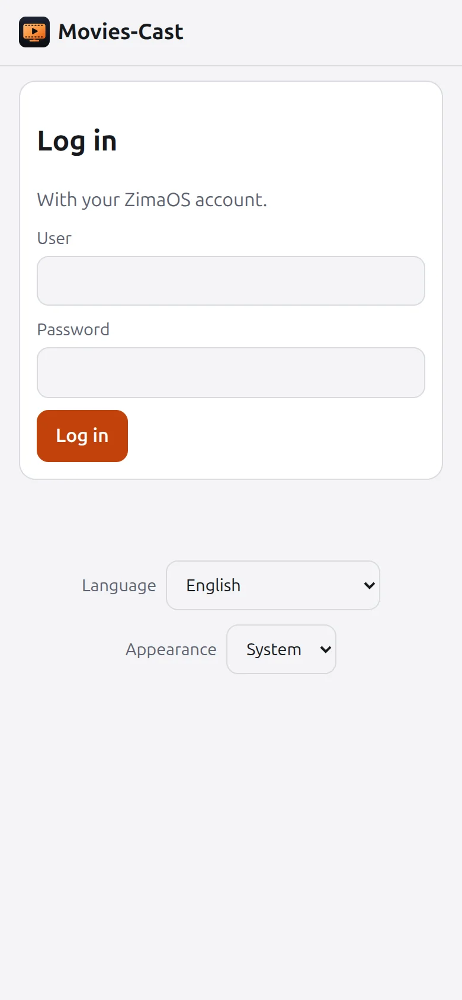
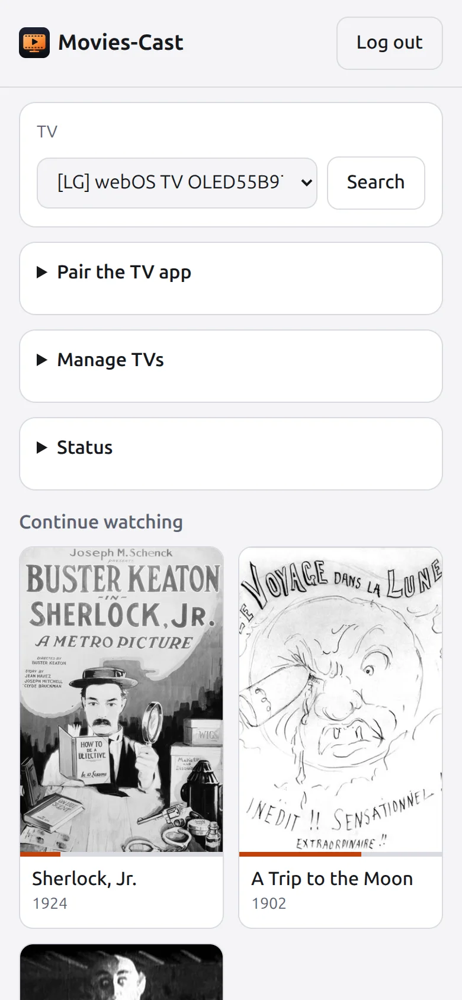
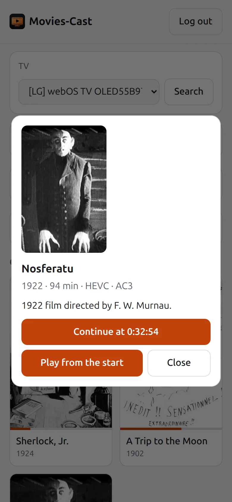
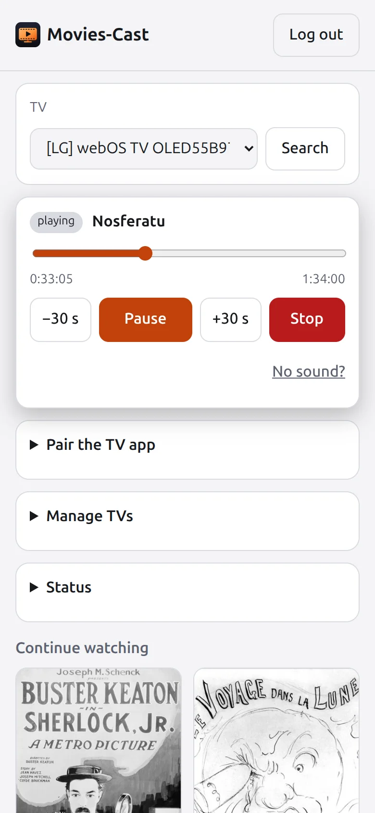
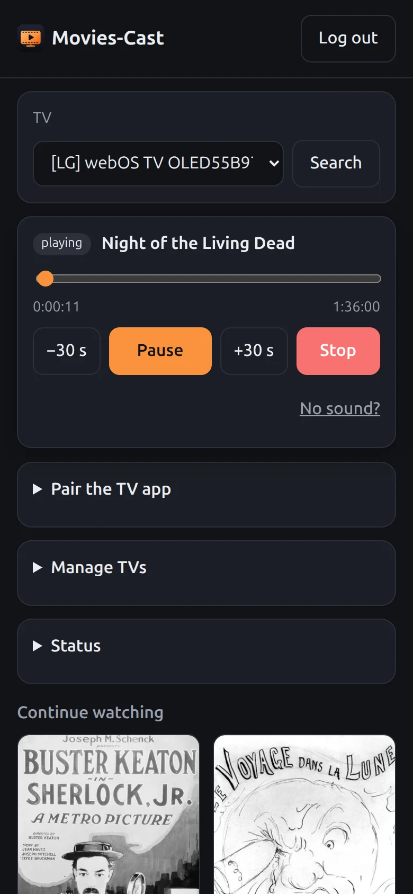
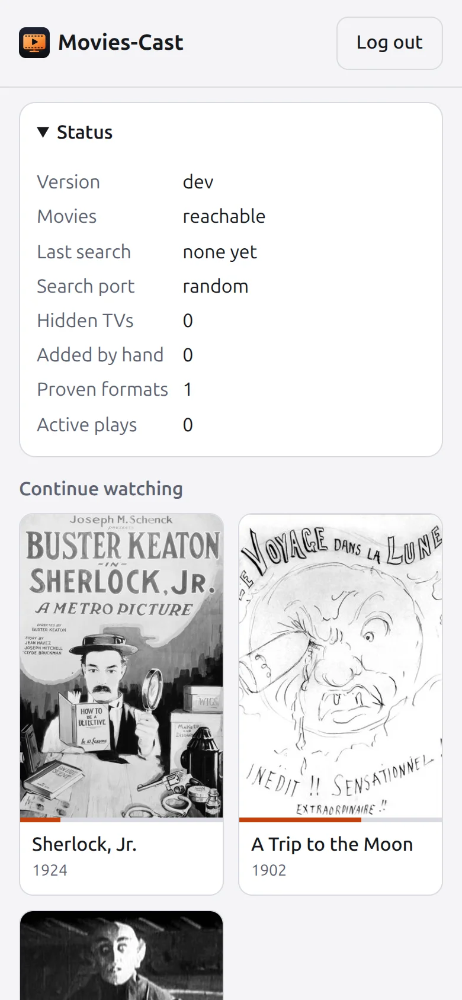
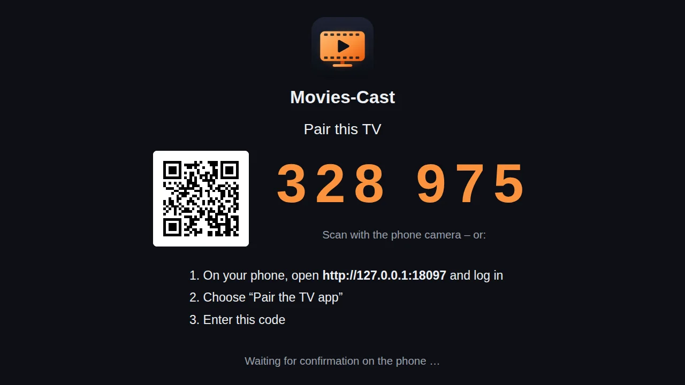
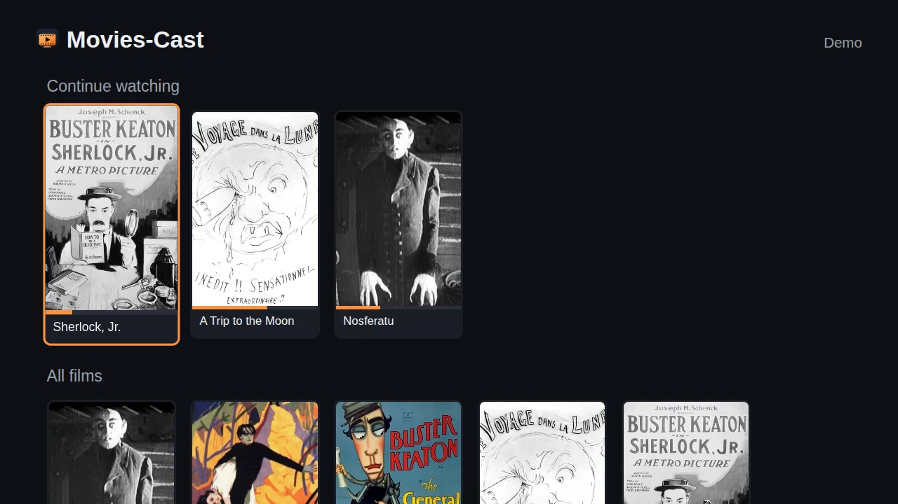

# Movies-Cast

Plays your films, series, music and photos on the TV, controlled from the phone browser — from IceWhale
**Movies** on ZimaOS, or from any **Jellyfin** or **Emby** server. The TV fetches the original file and decodes
it itself: no transcoding, no load on the NAS (sound can be converted on request, the picture never is).

```
phone ──HTTP(S)──> Movies-Cast :8097 ──Jellyfin API──> Movies / Jellyfin / Emby
                        │  DLNA (AVTransport) or Google Cast          ▲
                        ▼                                             │ bytes, token in a header
                       TV ──GET /s/<play-id>/movie.mkv──> Movies-Cast
```

## What it does

- **Library on the phone:** films, series with their episodes, music albums and photos (tabs show only what
  the server has; Movies 0.3.0 has films only), search, sort (name, recently added, year, rating), filter
  (unwatched, started, genre), "Continue watching".
- **Sends to the TV:** DLNA TVs (LG, Samsung, Sony, Philips …), Google Cast devices (Chromecast, Google TV,
  TVs with Chromecast built-in), and **Kodi** on Android TV / Nvidia Shield — through Kodi's own player, with
  Kodi's sound (see [TVs and boxes](#tvs-and-boxes)).
- **Remote on the phone:** pause, ±30 s, seek, volume, stop; the next episode follows by itself, a queue
  plays in order; the resume point goes back to the server.
- **Subtitles** to DLNA TVs (SRT, picked on the phone) and in the TV apps.
- **"No sound?"** converts only the sound (AAC) for TVs that cannot decode AC3/E-AC3/DTS.
- Sleep timer, a diagnostics file for TV reports (formats per TV model, no addresses).
- Wake-on-LAN for TVs in standby, 18 languages, light/dark, HTTPS with a `__Host-` cookie, accessibility
  checked with axe (WCAG 2.1 AA).

## Requirements

- **A media server:** IceWhale Movies on ZimaOS (`zimaos-movies` 0.3.0 or later; a beta, not in the ZimaOS
  App Store — that is IceWhale's decision), **or** a Jellyfin (10.11 measured) or Emby (4.10 measured) server
  anywhere in the network. With Jellyfin or Emby, Movies-Cast runs on any Docker host, not only ZimaOS.
- **Movies-Cast** itself: a Docker container (x86-64 image on ghcr.io), port 8097.
- **A TV** that is a DLNA media renderer or a Google Cast device, or an Android TV box with Kodi. The phone
  only needs a browser.

## Install (testers)

Movies-Cast is a second app on ZimaOS next to IceWhale Movies. **Your phone is the remote; nothing is
installed on the TV** — the TV only has to be a DLNA media renderer and plays the file itself. The TV app
for LG webOS (pairing code, library on the TV) is not part of the testers' package; for Android TV (Shield) there is a test APK in the
release, see [TVs and boxes](#tvs-and-boxes) and [docs/TECHNICAL.md](docs/TECHNICAL.md#android-tv-app-shield-google-tv-test-build).

The easiest way: add the Lintuxer app store to ZimaOS (App Store → add a source →
`https://chicohaager.github.io/zima-appstore/store.json`) and install **Movies-Cast** there. Or by hand:

1. Download `movies-cast-<version>.zip` from the [latest release](https://github.com/chicohaager/movies-cast/releases/latest) and unpack it.
2. Open `GUIDE.en.html` (German: `ANLEITUNG.de.html`, French: `GUIDE.fr.html`) from the zip in a browser.
3. In the ZimaOS dashboard: "+" next to Apps → install a custom app → "Import" → "Docker Compose" →
   `docker-compose.yml` from the zip → install.
4. On the phone open `http://<address-of-your-ZimaOS>:8097`, log in with the ZimaOS account, pick the TV
   and a film. If a TV or box is missing from the list, the text below the list says why.

See [Requirements](#requirements). With a Jellyfin or Emby server instead of Movies: set `MOVIES_URL` in the compose to its address and log in with that server's account.

## Use

The phone shows the same "Weiterschauen" row above all films; it reloads when a film on the TV ends
or is stopped, so the new resume point appears.

Open `http://<nas>:8097` on the phone — for example `http://10.0.0.10:8097` in the home Wi-Fi,
`http://100.64.0.10:8097` (or `http://my-nas:8097`) via Tailscale from outside; if the NAS
advertises no subnet route, the LAN address does not work over Tailscale. Log in with the **ZimaOS account**, pick a film, pick the TV,
press play. Pause, ±30 s, seek bar, stop and "continue at" work; progress goes back to Movies, and
each stop is logged with film, position and outcome (`report stopped <film> at 0:01:41: ok`).

- **Manage TVs** (card on the phone): give a TV a name ("Living room"), hide one (a TV nobody uses),
  or add one by IP when the search cannot see it. Stored in `tvs.json` next to `STATE_FILE` (0600);
  an added IP is searched like a `RENDERERS` host. An empty list says why: no answer at all to the
  search (firewall?), answers but no video device, or every TV hidden.
- **Status** (card on the phone): version, Movies reachable (`/System/Info/Public`, no token), last
  search (time, answers, TVs), search port held, hidden/added TVs, proven formats, active plays.

## TVs and boxes

| TV / box | How | Sound | Measured |
|---|---|---|---|
| DLNA TV (LG webOS, Samsung, …) | the phone sends, the TV fetches the file | the TV's decoders; "No sound?" converts to AAC | LG OLED55B97LA: films, episodes with autoplay, music, photos, SRT subtitles fetched (2026-10-31) |
| Google Cast (Chromecast, Google TV) | found by mDNS, Default Media Receiver | the device's decoders | against a test receiver only: no Cast device on the owner's LAN |
| **Android TV / Nvidia Shield with Kodi** | Movies-Cast app on the box, "Play with: Kodi" — or Kodi alone as a DLNA TV | **Kodi's player** (passthrough of AC3/E-AC3/DTS to the AV receiver as Kodi is set up) | a tester's Shield TV Pro played a film sent from the phone in Kodi (2026-10-30); the app's Kodi path in the Android TV emulator with Kodi 21.3 (2026-10-31) |
| LG webOS TV app | Movies-Cast app on the TV (developer mode) | the TV's decoders | see [docs/TECHNICAL.md](docs/TECHNICAL.md#tv-app-webos-stage-2) |
| Apple TV, AirPlay | not supported | — | paired Apple TV 4K accepts AirPlay `/play` but never fetches the file, pyatv 0.18.0 the same (2026-10-31) |

**Kodi on the Shield is the way to good sound on Android TV.** Kodi plays the file in its own player — like
it does for Jellyfin, Plex or Emby when they use Kodi as external player — so the formats the Android
WebView cannot play with sound (on a tester's Shield: AAC silent; no audio track choice in any Android
WebView) play there. Two ways:

1. **Movies-Cast app + Kodi** (recommended): install the Android TV app (APK in the release) and Kodi, open a
   film, choose **"Play with: Kodi"** once (kept on the box). If Kodi's UPnP is on (below), the film goes to
   Kodi by DLNA: resume, progress, next episode and the phone's remote work. Without UPnP the app hands the
   film to Kodi directly (starts from the beginning, no progress back).
2. **Kodi alone:** in Kodi, *Settings → Services → UPnP/DLNA*: "Enable UPnP support" and "Allow remote
   control via UPnP". The box then appears in the phone's TV list like a DLNA TV.

## Configuration (environment)

| Variable | Default | Meaning |
|---|---|---|
| `LISTEN` | `:8097` | listen address |
| `MOVIES_URL` | `http://127.0.0.1/movies` | the media server: Movies on ZimaOS (`…/movies`), or a Jellyfin (`http://host:8096`) or Emby (`http://host:8096/emby`) server |
| `PUBLIC_URL` | derived per TV | URL the TV uses to reach this server |
| `RENDERERS` | — | comma-separated DLNA description URLs **or hosts**, in addition to SSDP; a host gets its current URL by SSDP (multicast and unicast), the last one found stands in when the TV misses a search |
| `SSDP_PORT` | `1901` | local UDP port of the SSDP search, so a firewall can allow the answers (`0` = any port) |
| `SSDP` | `true` | `false` turns discovery off |
| `CAST` | `true` | `false` turns the search for Google Cast devices (mDNS) off |
| `TLS_LISTEN` | — | also serve the phone page over HTTPS here, e.g. `:8443`; TVs keep fetching films over HTTP |
| `TLS_CERT`, `TLS_KEY` | — | certificate and key for HTTPS (e.g. from `tailscale cert`); without them a self-signed one is created once in `TLS_DIR` |
| `TLS_DIR` | the `STATE_FILE`'s directory | where the self-signed certificate lives (key 0600) |
| `STATE_FILE` | — | keeps sessions, TV names and settings across restarts (0600) |

Why the search port is fixed and what a firewall needs: [docs/TECHNICAL.md](docs/TECHNICAL.md#search-port-and-firewall).

## Screenshots

The phone page and the TV page in English, from the dev server with a demo library of public-domain
films (posters and facts: [docs/screenshots/demo/SOURCES.md](docs/screenshots/demo/SOURCES.md); the TV
is the fake TV of the tests).

<p>




</p>
<p>


</p>

Log in · library with "Continue watching" · film · player · dark mode · status.

<p>


</p>

The TV page (TV app, not in the testers' package): pairing with a code from the phone, then the library.

To take them again: start the dev server with the demo library and open `http://127.0.0.1:18097/?lang=en`
(log in as Demo, password "richtig"):

```bash
MC_DEV_LIBRARY=../../docs/screenshots/demo MC_DEV_SERVER=127.0.0.1:18097 go test -count=1 ./internal/server/ -run TestDevServer -timeout 0 -v
```

## More

- [docs/TECHNICAL.md](docs/TECHNICAL.md): how it works and what was measured (format hint, converted
  sound, Wake-on-LAN, LG quirks, security, build/test/deploy, the TV apps)
- [docs/ROADMAP.md](docs/ROADMAP.md): what is done and what is next · [CHANGELOG.md](CHANGELOG.md)
- [docs/TRANSLATIONS.md](docs/TRANSLATIONS.md): the 18 languages and how to correct one
- [CONTRIBUTING.md](CONTRIBUTING.md): reporting a TV, a bug or a translation
- [docs/WEBOS-STORE.md](docs/WEBOS-STORE.md): the webOS app for the LG Content Store — what is ready, what LG asks for

## License

MIT, see [LICENSE](LICENSE).
